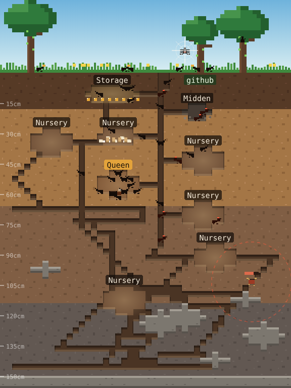
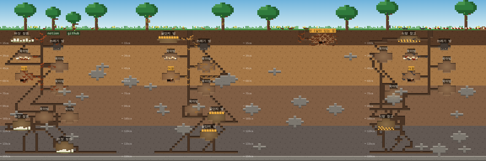
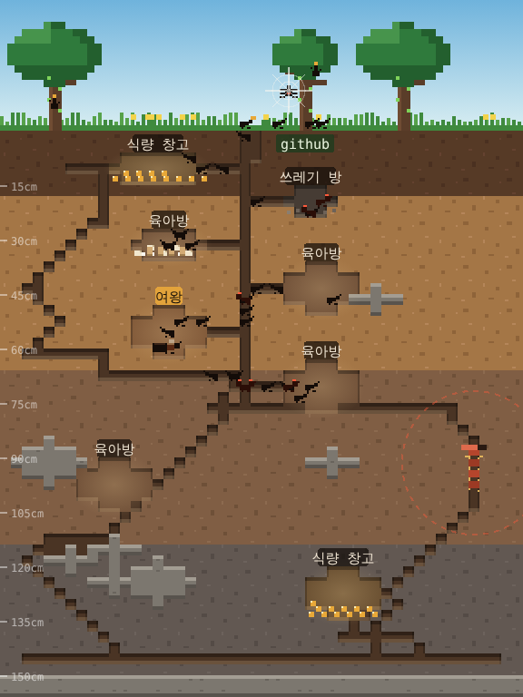

# 🐜 Ant Nest · 개미굴 — a Claude Code plugin that turns your AI coding into an ant colony

**A pixel-art ant colony simulation that lives beside Claude Code and grows with how you use AI.** Explore and your foragers bring food home. Edit and they dig. Pass tests and they hunt. Hit the same bug three times and a centipede breaks in. Fix it and the colony eats well.

**Claude Code 옆에서 살아 움직이는 도트 개미 군락 시뮬레이션. 내 AI 활용이 군락의 먹이이자 날씨가 됩니다.**

[](LICENSE)  

<p align="center"></p>

```
/plugin install ant-nest --marketplace findot-ai/ant-nest
```

**English** · [한국어](#한국어) · [Show your colony](https://github.com/findot-ai/ant-nest/issues/new?template=show-your-colony.yml)

A colony of Japanese carpenter ants (*Camponotus japonicus*) lives beside your Claude Code session. Time runs only while you are connected: 30 minutes connected is one game day and about 35 hours is a game year. One generation, the life of one queen, lasts roughly 3 months of everyday use. Seasons turn, brood grows with soil temperature, and the frost line creeps down in winter. Think of it as a Tamagotchi for your AI workflow, built on real ant ecology.

The colony's food and weather come from how you use AI. The mod never reads your code or conversation. It looks only at tool names and whether each call succeeded.

## How your AI use maps to the nest

| What you do in Claude Code | What happens in the nest |
|---|---|
| Explore: read files, search, web research | Foragers climb trees and bring back honeydew |
| Edit and write files | Digging: new tunnels and chambers. More storage rooms mean bigger reserves |
| Tests or builds pass | A successful hunt: protein, which grows majors (big-headed soldiers) |
| Delegate to a subagent | The queen lays extra eggs |
| Several agents at once, workflows, worktrees | An expedition files out of the nest |
| Use an MCP server (external tool) | Each server becomes an outside pasture: a new aphid tree the ants herd |
| Reuse a skill | The pheromone trail gets stronger and foraging speeds up |
| Set up automation: scheduled tasks, wakeups, triggers, background runs, headless sessions | Instinct: the colony earns more on its own, even when you are away |
| Plan: todo lists, plan mode | Blueprints: extra digging and a little food |
| An error | A spider spins a web on the foraging trail |
| The same tool fails 3 times in a row | A centipede breaks in. Alarm pheromone spreads and the ants swarm it |
| The failing tool succeeds again | Bug fixed: the centipede goes down and becomes protein |
| A test fails | Rain |
| A long conversation gets summarized | A mole passes and part of the storage caves in |
| An unfamiliar tool | The colony guesses its job from the name and remembers it |

Over time your usage pattern gives the colony a type: Scout, Builder, Hunter, Delegator, Herder (MCP-heavy), Trailblazer (skill-heavy) or Instinct (automation-heavy).

The colony never dies from your work. The queen can weaken, but idle days are just quiet days.

## Your colony starts from your history

The first time the plugin runs, it looks at your local Claude Code history on your own machine: which tools you used in recent conversations, keyword categories in your prompts (debugging, research, planning, automation, building), and the MCP servers, skills and hooks you have set up. It keeps only the counts and never stores or sends prompt text.

From that it picks your starting colony:

- **Size:** new users start with a lone founding queen, regular users with a second-year colony, heavy users with a third-year colony
- **Species:** heavy MCP use → leafcutter ants, automation → honeypot ants, parallel agents → army ants, delegation → samurai ants, otherwise Japanese carpenter ants (or wood ants for newcomers)
- **Head start:** your MCP servers become outside pastures, skills become pheromone trails, hooks become instinct

Only the 15 most recent conversation files under 4 MB are read.

## Species

<p align="center"></p>

| Species | Real ecology | Strong at |
|---|---|---|
| Japanese carpenter ant *Camponotus japonicus* | Deep chambers, big-headed majors | Balanced |
| Japanese wood ant *Formica japonica* | Common and fast-growing; adopts young queens after the nuptial flight, so the colony carries on when a queen dies | Exploring, editing; a gentle start |
| Leafcutter ant *Atta cephalotes* | The queen carries a fungus pellet in her mouth pouch; workers cut leaves to feed the garden. Tropical, no winter | MCP tools (the leaf supply) |
| Honeypot ant *Myrmecocystus mexicanus* | Repletes hang from the ceiling as living honey jars. Colonies hold display tournaments; a much weaker colony gets raided for brood and repletes. Desert | Automation and reserves |
| Army ant *Eciton burchellii* | No dug nest: a living bivouac of linked bodies. Lays only in the ~20-day statary phase, raids daily in the ~14-day nomadic phase. Wingless queens, so colonies split instead of flying | Parallel agents and tests |
| Samurai ant *Polyergus samurai* | Slave-maker: samurai never forage or nurse. Scouts find wood ant nests, the column raids them for pupae, and the wood ants that hatch do all the work as slaves. No raids, no slaves, and the colony starves | Delegation (each delegation sends a raid) |

`/ant species` lists them; `/ant new <species>` starts a new colony with one (for example `/ant new atta`).

## Generations and colony level

A queen lives 5 to 10 game years depending on the species. Once the colony is big enough, winged queens and males leave on a nuptial flight in early summer. When the old queen dies, one of those young queens founds the next generation. If no flight ever happened, the colony scatters and a stranger queen settles the empty ground.

Your colony level grows with peak population, years survived, bugs fixed and generations carried on. It shows on the pane and in `/ant stats`, together with the record of past generations.

## Show your colony

Run `/ant stats`, take a screenshot, and post it with the [Show your colony](https://github.com/findot-ai/ant-nest/issues/new?template=show-your-colony.yml) form. Colonies appear in the Colony Hall (issues labeled `colony-hall`).

## Commands

- `/ant`: open the nest pane
- `/ant stats`: your usage so far, colony type, tools learned
- `/ant species`: list the species
- `/ant new <species>`: start a new colony with that species
- `/ant reset`: start over from scratch

Language follows your system locale. Change it under the plugin's settings (`language`: `auto`, `ko`, `en`).

## Install

At the prompt of a Claude Code terminal session:

```
/plugin install ant-nest --marketplace findot-ai/ant-nest
```

Answer `y` to add the marketplace, then pick the user scope.

From a shell:

```
claude plugin install ant-nest --marketplace findot-ai/ant-nest
```

In the desktop app: click + next to the prompt box, then Plugins, Add marketplace with `findot-ai/ant-nest`, then Add plugin.

The desktop app draws the nest as pixel art in a side pane. A terminal draws it with half-block characters. On a narrow terminal the pane does not open by itself; use `/ant`.

---

## 한국어

<p align="center"></p>

Claude Code 옆에서 일본왕개미 군락이 살아 움직입니다. 시간은 접속해 있을 때만 흐릅니다. 접속 30분이 게임 하루, 약 35시간이 게임 1년입니다. 여왕 한 마리의 일생인 한 세대는 매일 쓰면 현실로 약 3개월입니다. 계절이 바뀌고, 새끼가 땅속 온도에 따라 자라고, 겨울에는 동결선이 내려옵니다.

군락의 먹이와 날씨는 당신의 AI 활용입니다. 코드나 대화 내용은 읽지 않고, 도구 이름과 성공 여부만 봅니다.

## 내 AI 활용이 개미굴에 반영되는 방식

| Claude Code에서 한 일 | 개미굴에서 |
|---|---|
| 탐색: 파일 읽기, 검색, 웹 조사 | 채집 개미가 나무에 올라 단물을 가져온다 |
| 편집·작성 | 굴착, 새 방. 창고가 늘면 비축할 수 있는 양이 커진다 |
| 테스트·빌드 통과 | 사냥 성공, 단백질 (병정개미가 자란다) |
| 서브에이전트에 일을 맡김 | 여왕이 알을 더 낳는다 |
| 여러 에이전트 동시 실행, 워크플로, 워크트리 | 원정대가 줄지어 굴을 나선다 |
| MCP 서버(외부 도구) 사용 | 서버 하나가 바깥 목초지 하나: 개미가 치는 진딧물 나무가 새로 생긴다 |
| 스킬 재사용 | 페로몬 길이 짙어져 채집이 빨라진다 |
| 자동화 설정: 예약 작업, 깨우기, 트리거, 백그라운드 실행, 사람 없이 도는 세션 | 본능: 내가 없어도 군락이 스스로 버는 양이 늘어난다 |
| 계획: 할 일 목록, 계획 모드 | 설계도: 굴착이 조금 더, 먹이도 조금 |
| 오류 | 채집 길목에 거미줄 |
| 같은 도구가 3번 연속 오류 | 지네 침입. 경보 페로몬이 퍼지면 개미들이 몰려든다 |
| 실패했던 도구가 다시 성공 | 버그를 잡았다: 지네 격퇴, 단백질이 된다 |
| 테스트 실패 | 비 |
| 긴 대화가 요약됨 | 두더지가 지나가며 창고 한쪽이 무너진다 |
| 처음 보는 도구 | 이름으로 일을 짐작해 배우고 기억한다 |

쓰는 패턴이 쌓이면 군락 유형이 정해집니다: 정찰형, 건축형, 사냥형, 분업형, 목축형(MCP 위주), 길잡이형(스킬 위주), 본능형(자동화 위주).

일 때문에 군락이 전멸하지는 않습니다. 여왕은 약해질 수 있지만, 쉬는 날은 조용히 지나갈 뿐입니다.

## 내 기록으로 시작하는 군락

처음 실행할 때, 내 컴퓨터에 있는 Claude Code 기록을 그 자리에서만 살펴봅니다. 최근 대화에서 쓴 도구, 프롬프트의 키워드 갈래(디버깅, 조사, 기획, 자동화, 개발), 설정해 둔 MCP 서버·스킬·훅을 봅니다. 남기는 것은 개수뿐이고, 프롬프트 원문은 저장하지도 보내지도 않습니다.

이걸로 시작 군락을 정합니다.

- **규모:** 처음 쓰는 사람은 여왕 혼자 창업, 꾸준히 쓰는 사람은 2년차 군락, 많이 쓰는 사람은 3년차 군락
- **종:** MCP를 많이 쓰면 잎꾼개미, 자동화는 꿀단지개미, 병렬 에이전트는 군대개미, 위임은 사무라이개미, 그 외에는 일본왕개미(처음이면 곰개미)
- **출발 보너스:** 내 MCP 서버는 바깥 목초지, 스킬은 페로몬 길, 훅은 본능이 됩니다

최근 대화 파일 중 4MB 이하인 15개만 읽습니다.

## 개미종

<p align="center"></p>

| 종 | 실제 생태 | 강한 활용 |
|---|---|---|
| 일본왕개미 *Camponotus japonicus* | 깊은 층층 방, 머리 큰 병정 | 균형형 |
| 곰개미 *Formica japonica* | 흔하고 빨리 자람. 결혼비행 뒤 젊은 여왕을 받아들여, 여왕이 죽어도 군락이 이어짐 | 탐색, 편집. 입문용 |
| 잎꾼개미 *Atta cephalotes* | 여왕이 입속 주머니에 버섯 균을 담아 와 정원을 차리고, 일개미가 잘라 온 잎으로 키움. 열대라 겨울이 없음 | MCP 외부 도구(잎 공급원) |
| 꿀단지개미 *Myrmecocystus mexicanus* | 꿀을 채운 일개미가 천장에 매달린 살아 있는 창고. 이웃과 과시 싸움(토너먼트)을 벌이고, 훨씬 약한 쪽은 습격당해 새끼와 꿀단지를 빼앗김. 사막 | 자동화, 비축 |
| 군대개미 *Eciton burchellii* | 굴 대신 몸을 엮은 살아 있는 둥지(비박). 정착기(약 20일)에만 산란, 유랑기(약 14일)에는 매일 사냥. 여왕은 날개가 없어 결혼비행 대신 군락이 둘로 갈라짐 | 병렬 에이전트, 테스트 |
| 사무라이개미 *Polyergus samurai* | 노예사냥개미. 스스로 채집도 육아도 안 함. 정찰병이 곰개미 둥지를 찾으면 떼 지어 번데기를 훔쳐 오고, 깨어난 곰개미가 노예로 모든 일을 함. 습격이 멈추면 굶음 | 위임 (위임할 때마다 노예사냥 출격) |

`/ant species`로 목록을 보고, `/ant new <종>`으로 그 종의 새 군락을 시작합니다(예: `/ant new atta`).

## 세대와 군락 레벨

여왕은 종에 따라 5~10 게임년을 삽니다. 군락이 충분히 크면 초여름에 날개 달린 신여왕과 수개미가 결혼비행을 나가고, 늙은 여왕이 죽으면 그중 하나가 다음 세대를 엽니다. 결혼비행을 한 번도 못 했다면 군락은 흩어지고, 빈 땅에 낯선 여왕이 내려앉습니다.

군락 레벨은 최대 개체수, 버틴 햇수, 고친 버그, 이어 간 세대로 오릅니다. 창과 `/ant stats`에 이전 세대 기록과 함께 나옵니다.

## 내 군락 자랑하기

`/ant stats` 결과와 스크린샷을 [내 군락 자랑하기](https://github.com/findot-ai/ant-nest/issues/new?template=show-your-colony.yml) 양식으로 올려 주세요. `colony-hall` 라벨이 붙은 이슈가 군락 명예의 전당이 됩니다.

## 명령

- `/ant`: 개미굴 창 열기
- `/ant stats`: 지금까지의 활용, 군락 유형, 배운 도구
- `/ant species`: 개미종 목록
- `/ant new <종>`: 그 종으로 새 군락 시작
- `/ant reset`: 처음부터 다시

언어는 시스템 언어를 따릅니다. 플러그인 설정의 `language`(`auto`, `ko`, `en`)에서 바꿀 수 있습니다.

## 설치

Claude Code 터미널 입력창에서:

```
/plugin install ant-nest --marketplace findot-ai/ant-nest
```

마켓플레이스 추가를 물으면 `y`, 범위는 사용자(user)를 고릅니다.

셸에서:

```
claude plugin install ant-nest --marketplace findot-ai/ant-nest
```

데스크톱 앱에서는 입력창 옆 + → Plugins → Add marketplace에 `findot-ai/ant-nest`를 넣고 Add plugin을 누릅니다.

데스크톱 앱에서는 옆 창에 도트 그림으로, 터미널에서는 반 블록 문자로 그립니다. 터미널 폭이 좁으면 창이 자동으로 뜨지 않으니 `/ant`로 여세요.

---

**Keywords:** Claude Code plugin, Claude Code mod, AI coding companion, developer Tamagotchi, gamification for developers, pixel art, ant colony simulation, ant farm, MCP, Claude Agent · 클로드 코드 플러그인, 개미 키우기, 개미 시뮬레이션, 개발자 게임
